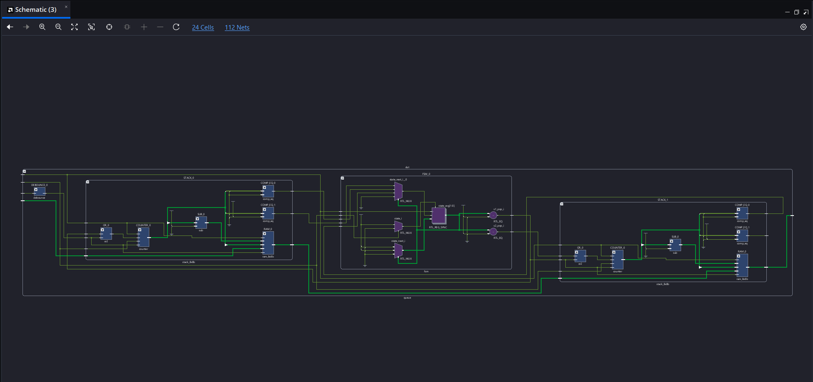
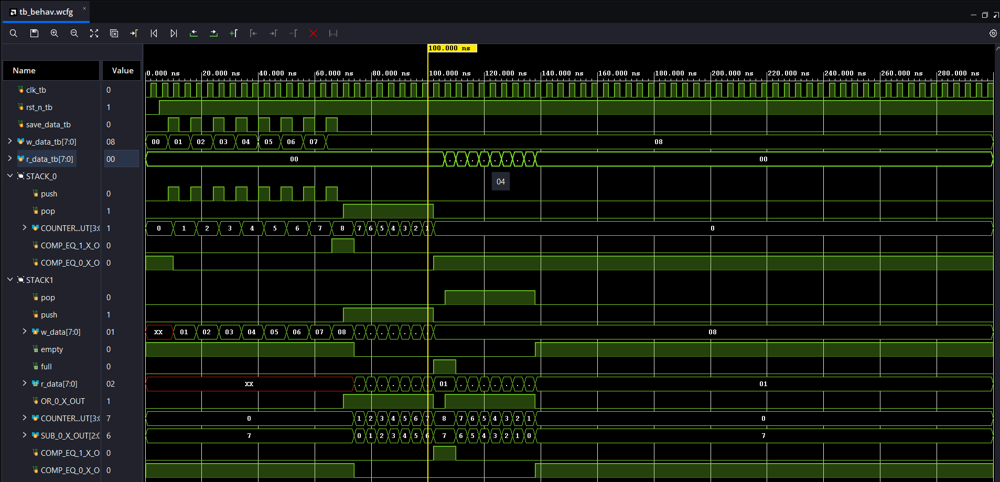

# Queue (FIFO) Built From Two Stacks — FPGA / Vivado

A hardware implementation of a **FIFO queue built from two LIFO stacks**, designed and simulated in **Xilinx Vivado**.  
Data is pushed into the first stack, transferred into the second stack (which reverses its order), and then popped out of the second stack — so the bytes come out in the same order they went in.

---

## Table of Contents
- [How It Works](#how-it-works)
- [Architecture](#architecture)
- [Module Overview](#module-overview)
- [Simulation](#simulation)
- [Project Structure](#project-structure)
- [Getting Started](#getting-started)

---

## How It Works

A stack is Last-In-First-Out. If you pop every element of one stack and push it into a second stack, the order is reversed. Reversing twice gives you the original order — that is the whole trick:

```
 write 00,01,...,07          transfer (reverses)          read
 ─────────────────►  STACK_0  ─────────────────►  STACK_1  ─────────►  00,01,...,07
                     (LIFO)                       (LIFO)
```

1. **Write phase** – each `save_data` pulse pushes the byte on `w_data[7:0]` into **STACK_0**.
2. **Transfer phase** – the FSM pops STACK_0 and pushes every value into **STACK_1** until STACK_0 is empty and STACK_1 is full.
3. **Read phase** – the FSM pops STACK_1; the bytes appear on `r_data[7:0]` in their original (FIFO) order.

---

## Architecture



The top-level `queue` design contains:

| Instance      | Module        | Role |
|---------------|---------------|------|
| `DEBOUNCE_0`  | `debounce`    | Cleans the `save_data` input (e.g. a push-button on the board) |
| `STACK_0`     | `stack_8x8b`  | Input stack – receives the written data |
| `FSM_0`       | `fsm`         | Control unit – decides when to push/pop each stack (`s1_pop`, `s2_pop`) |
| `STACK_1`     | `stack_8x8b`  | Output stack – holds the reversed data and drives `r_data` |

### Inside each `stack_8x8b`

Each stack is an **8 × 8-bit** memory with a stack pointer:

| Instance      | Module       | Role |
|---------------|--------------|------|
| `RAM_0`       | `ram_8x8b`   | 8 words × 8 bits storage |
| `COUNTER_0`   | `counter`    | Up/down stack pointer (`COUNTER_OUT[3:0]`, 0–8): +1 on push, −1 on pop |
| `OR_0`        | `or2`        | `push OR pop` → counter enable |
| `SUB_0`       | `sub`        | `counter − 1` → address of the top element (`SUB_0_X_OUT[2:0]`) used for reads |
| `COMP_EQ_0`   | `comp_eq`    | `counter == 0` → **empty** flag |
| `COMP_EQ_1`   | `comp_eq`    | `counter == 8` → **full** flag |

### FSM

`FSM_0` is a small state machine (`state_reg[1:0]`) that uses the empty/full flags of both stacks to sequence the write → transfer → read phases, driving the `push`/`pop` signals of each stack.

---

## Module Overview

**Top-level ports**

| Signal          | Direction | Width | Description |
|-----------------|-----------|-------|-------------|
| `clk`           | in        | 1     | System clock |
| `rst_n`         | in        | 1     | Active-low synchronous reset |
| `save_data`     | in        | 1     | Push the current `w_data` into the queue |
| `w_data`        | in        | 8     | Data to write |
| `r_data`        | out       | 8     | Data read from the queue |

---

## Simulation

The testbench (`tb`) releases reset, then pulses `save_data` eight times while presenting `00`, `01`, … `07` on `w_data`.



What the waveform shows:

| Time (approx.) | Event |
|----------------|-------|
| 0 – 65 ns      | 8 pushes into **STACK_0**; its counter climbs 0 → 8 and `COMP_EQ_1` (full) asserts |
| 65 – 100 ns    | **Transfer**: STACK_0 `pop` and STACK_1 `push` are high together; STACK_0 counts 8 → 0 while STACK_1 counts 0 → 8 |
| ~100 ns        | STACK_0 is **empty**, STACK_1 is **full** |
| 105 – 125 ns   | STACK_1 is popped; the stored bytes are output on `r_data_tb` and STACK_1 counts back down to 0 |
| > 125 ns       | Both stacks empty – the queue is ready for new data |

---

## Project Structure

```
.
├── src/
│   ├── queue          # top level
│   ├── fsm
│   ├── debounce
│   ├── stack_8x8b
│   ├── ram_8x8b
│   ├── counter
│   ├── sub
│   ├── comp_eq
│   └── or2
├── sim/
│   └── tb             # testbench
├── docs/
│   ├── schematic.png
│   └── waveform.png
└── README.md
```

---

## Getting Started

1. Clone the repository
   ```bash
   git clone https://github.com/<your-username>/<your-repo>.git
   ```
2. Open **Vivado** and create a new RTL project.
3. Add the files from `src/` as **design sources** and `sim/tb` as a **simulation source**.
4. Run **Flow → Run Simulation → Run Behavioral Simulation** to reproduce the waveform above.
5. Run **Open Elaborated Design → Schematic** to view the RTL schematic.
6. *(Optional)* Add a constraints file for your board and run synthesis / implementation to try it on hardware.

---

## License

This project is released under the MIT License — see `LICENSE` for details.
